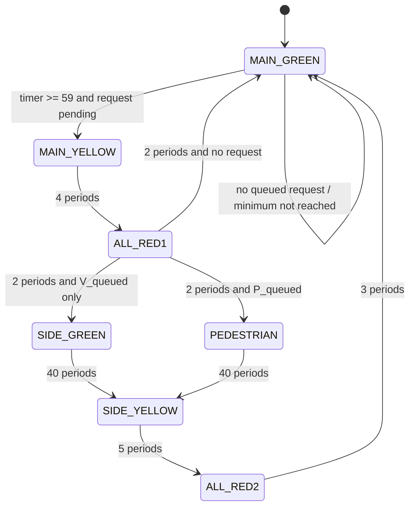

# FSM State Diagram

The controller has seven states. The synthesizable DUT uses one-hot encoding; the reference model uses binary encoding.

## State outputs

| State | Main light | Side light | Walk |
|---|---|---|---|
| MAIN_GREEN | Green | Red | 0 |
| MAIN_YELLOW | Yellow | Red | 0 |
| ALL_RED1 | Red | Red | 0 |
| SIDE_GREEN | Red | Green | 0 |
| PEDESTRIAN | Red | Red | 1 |
| SIDE_YELLOW | Red | Yellow | 0 |
| ALL_RED2 | Red | Red | 0 |

At ALL_RED1, a pending pedestrian request has priority over a vehicle request. A pedestrian request arriving during SIDE_GREEN remains queued for the next cycle.
