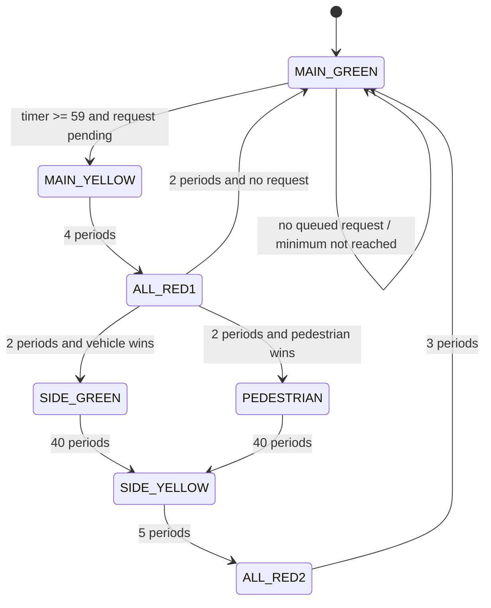

# FSM State Diagram

The controller has seven states. The synthesizable DUT uses one-hot encoding; the reference model uses binary encoding.

## State outputs

| State | Main light | Side light | Walk |
|---|---|---|---|
| MAIN_GREEN | Green | Red | 0 |
| MAIN_YELLOW | Yellow | Red | 0 |
| ALL_RED1 | Red | Red | 0 |
| SIDE_GREEN | Red | Green | 0 |
| PEDESTRIAN | Red | Red | 1 |
| SIDE_YELLOW | Red | Yellow | 0 |
| ALL_RED2 | Red | Red | 0 |

## Arbitration at ALL_RED1

| P_queued | V_queued | FAIR_ARB=0 | FAIR_ARB=1 |
|---|---|---|---|
| 1 | 0 | PEDESTRIAN | PEDESTRIAN |
| 0 | 1 | SIDE_GREEN | SIDE_GREEN |
| 1 | 1 | PEDESTRIAN | the one **not** served last time |
| 0 | 0 | MAIN_GREEN (unreachable in practice) | MAIN_GREEN |

A pedestrian request arriving during SIDE_GREEN remains queued for the next cycle
(and a vehicle request arriving during PEDESTRIAN likewise).

Durations above are the defaults and are counted in ticks (`tick` enable);
`traffic_ctrl` ties `tick` high, so they are clock periods.
